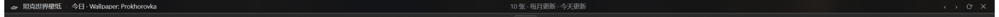

# dsh-wot-wallpaper

A background plugin for the DeepSeek Harness web GUI: official **World of Tanks**
artwork behind the conversation, refreshed at most once a month, a different
picture every day.



## 中文说明

给 DeepSeek Harness 网页界面加一个"坦克世界"壁纸背景：从**官网**媒体库里抓坦克战场图，
每 30 天最多下载一次，保留 10 张，每天按本地日期换一张。

- **图源**：`worldoftanks.eu` 媒体库的壁纸标签页，只下官网 `wgcdn.co` 上的图；
  宣传拼贴、万圣节人物立绘会被降权，优先留坦克战场图。
- **每月最多一次**：距上次下载不足 30 天就不联网；失败后 1 小时不重试。
- **留 10 张**：1920×1080 优先，其次 2560×1440 等官方尺寸；换批次时删掉旧文件。
- **每天一张**：只由本地日期决定，零点自动换，多窗口一致。
- **底部控制条**：`‹` `›` 换上一张/下一张，`⟳` 立即重下，`✕` 关掉壁纸。
- **半透明化**：壁纸画在窗口框架上，侧栏、右侧面板、输入框都改成毛玻璃，
  中间区加轻模糊 + 主题色遮罩，浅色/深色主题都能正常读字。

数据放在 `$DSH_HOME/cache/wot-wallpaper/`（默认 `~/.dsh`）：`images/*.jpg` +
`state.json`。整个目录删掉也安全，下次刷新会重下。

> 非官方作品，与 Wargaming 无关；壁纸版权归 Wargaming 所有，插件本身不打包任何图片。

## English

A background (wallpaper) plugin for the DeepSeek Harness web GUI, themed on
*World of Tanks* tanks.

- **Source** — the official World of Tanks media gallery (`worldoftanks.eu`,
  wallpaper tag). Only art published there is used; nothing is bundled with the
  package.
- **At most one download a month** — if the newest batch is younger than 30 days,
  nothing is fetched. A failed attempt is not retried for an hour.
- **About ten pictures kept** — the ten best tank-scenario wallpapers of the
  listing, 1920×1080 first (2560×1440 and other official sizes as fallbacks).
  Promo collages and character portraits rank last.
- **One picture per day** — the picture of the day is a pure function of the
  local date; the bar's arrows shift the sequence without touching the rhythm.
- **Glass chrome** — the picture is painted on the window frame and the sidebar,
  right dock and composer become frosted panels, so text stays readable in both
  themes.
- **Data** — `$DSH_HOME/cache/wot-wallpaper/` (`images/` + `state.json`).

Not affiliated with Wargaming. The artwork belongs to Wargaming; the plugin only
downloads it at runtime.

## Install

The package is a DSH *bundle*: it inserts its own plugin row through
`cordis.patch.yml`. Clone it anywhere, then install that directory:

```
git clone https://github.com/hupinghit/dsh-WOT-Skin.git wot-wallpaper
```

From the npm registry:

```json
{ "action": "install_bundle", "target": "dsh-wot-wallpaper@0.1.0" }
```

From a local checkout (what the DSH app's *Settings → Plugins → install a local
bundle* does; the target is the folder that holds `package.json`):

```json
{ "action": "install_bundle", "target": "F:\\path\\to\\wot-wallpaper" }
```

Then reload the page once (`Ctrl+R`) so the client half is loaded.

## Uninstall

Disable or remove the `坦克世界壁纸 / WoT wallpaper` row in Settings → Plugins.
The downloaded pictures stay in `$DSH_HOME/cache/wot-wallpaper/`; delete that
folder to reclaim the space.

## HTTP surface

Served by the host half on the GUI's own origin (no extra permission needed):

| route | |
| --- | --- |
| `GET /wot-wallpaper/state` | JSON: enabled flag, picture list, today's index, last error |
| `GET /wot-wallpaper/img/<id>` | the JPEG/PNG bytes (cached for a week) |
| `POST /wot-wallpaper/action` | `{"action":"next"\|"prev"\|"refresh"\|"enable"\|"disable"\|"reset"}` |

## How it works

- `index.js` (host) — scrapes the official gallery, ranks candidates, downloads
  into the cache with an atomic write, prunes old files, serves the routes above.
  Refresh is budgeted (8 min) and runs at most once per interval.
- `client.js` (browser) — registers a `shell.bottom` bar, polls the state, and
  injects one stylesheet that paints the frame and makes the chrome translucent.
  Everything it adds is removed when the plugin is disposed.

## Limits

- The European gallery has not published new wallpapers since 2023, so a monthly
  refresh may legitimately return the same ten pictures.
- Downloading needs the host to reach `worldoftanks.eu`; without a network the
  previously downloaded pictures keep rotating.
- The CSS targets DSH 0.2.x layout class names (`_frame`, `_sidebarCol`,
  `_centerCol`, `_tabHost_`); a DSH release that renames them needs a selector
  refresh.

## License

MIT for the plugin code. The wallpaper artwork is © Wargaming.
